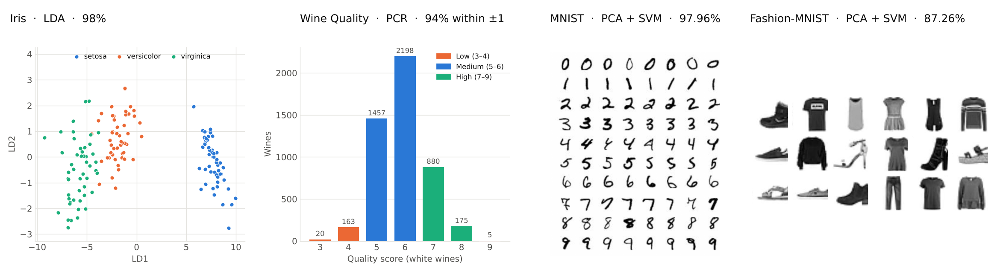

# Supervised Classification: from Iris to Fashion-MNIST (R)


How do classical statistical models cope as data gets harder? This project applies multivariate methods to four datasets of increasing complexity, from four flower measurements to 784-pixel images, and focuses on checking assumptions, pre-processing, outliers and the trade-off between accuracy and computational cost, not only on the final score.

BSc final project (*Projeto Integrador de 1.º Ciclo*) in Applied Mathematics and Computation, Instituto Superior Técnico, 2026. Individual work.



## Results

| Dataset | Size | Method | Result |
|---|---|---|---|
| **Iris** | 150 × 4 | Linear Discriminant Analysis | **98%** leave-one-out accuracy |
| **Wine Quality** (white) | 4,898 × 11 | log transform + PCA + LDA (Low / Medium / High) | 75.2% test accuracy |
| **Wine Quality** (white) | 4,898 × 11 | log transform + Principal Component Regression | MAE **0.60**; **94.0%** of predictions within ±1 point |
| **MNIST** | 70,000 × 784 | PCA (70% variance, 26 PCs) + RBF SVM | **97.96%** test accuracy |
| **Fashion-MNIST** | 70,000 × 784 | PCA (80% variance, 24 PCs) + RBF SVM | **87.26%** test accuracy |

## Highlights

- **Iris:** LD1 alone carries 99.15% of the between-class separation. All errors sit on the Versicolor/Virginica boundary, and removing the 4 IQR outliers leaves accuracy practically unchanged (97.95%), so the decision boundaries are stable.
- **Wine Quality:** five strongly skewed variables (skewness > 1) are log-transformed before PCA. Classification into three groups looks good at 75%, but it recognises only 23% of the low-quality and 18% of the high-quality wines, because the Medium class dominates. Treating quality as a continuous score with PCR describes human taste much better: 94% of predictions fall within one point. Removing ~20% of the sample as "outliers" made both models *worse*, which shows those wines were real variation rather than errors.
- **MNIST:** the number of components was chosen on a held-out validation split (8,000 / 2,000 training images) by testing variance targets from 50% to 95%. Too few components underfit, too many add noise; 70% (26 PCs instead of 784) costs only 0.37 points of accuracy against 80% (43 PCs).
- **Fashion-MNIST:** the same pipeline reaches 87%; most errors are between Shirt, T-shirt/top, Pullover and Coat, which share shapes at 28 × 28 pixels.
- Clean train / validation / test separation throughout: model choices are made on validation data, and the test set is used once.

## Structure

```
analysis/
  01_iris_lda.Rmd                Exploration, normality checks, LDA, cross-validation, outliers
  02_wine_quality_lda.Rmd        Skewness, log transform, PCA, LDA on quality groups, robustness
  03_wine_quality_pcr.Rmd        Same pipeline, Principal Component Regression on the exact score
  04_mnist_pca_svm.Rmd           Normalisation, PCA variance search, RBF SVM, confusion matrix
  05_fashion_mnist_pca_svm.Rmd   Same pipeline on clothing images
report/
  thesis_pt.pdf                  Full report (in Portuguese)
figures/
  overview.png                   Image at the top of this README
```

## Running it

Open any notebook in RStudio and click **Knit**, or run:

```r
install.packages(c("ggplot2", "GGally", "MASS", "psych", "corrplot", "dplyr", "tidyr",
                   "gridExtra", "EnvStats", "e1071", "FactoMineR", "factoextra", "dslabs",
                   "rmarkdown"))

rmarkdown::render("analysis/01_iris_lda.Rmd")
```

**Data:** no data is stored in this repository. Each notebook downloads its dataset into `analysis/data/` on the first run:

- [Iris](https://archive.ics.uci.edu/dataset/53/iris) and [Wine Quality](https://archive.ics.uci.edu/dataset/186/wine+quality) from the UCI Machine Learning Repository (CC BY 4.0)
- [MNIST](http://yann.lecun.com/exdb/mnist/) through the `dslabs` package
- [Fashion-MNIST](https://github.com/zalandoresearch/fashion-mnist) from Zalando Research (MIT licence)

The image notebooks train an SVM on 60,000 images, which takes a while; the trained model is cached as an `.rds` file so later runs are fast.

## Author

Carolina Baptista, Instituto Superior Técnico.
